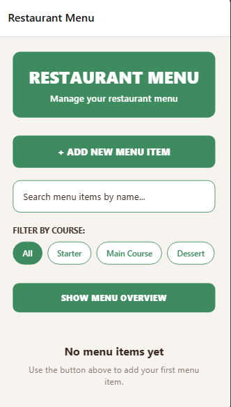
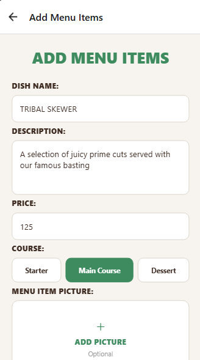
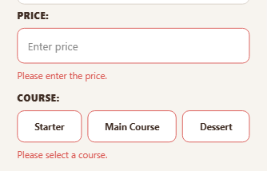
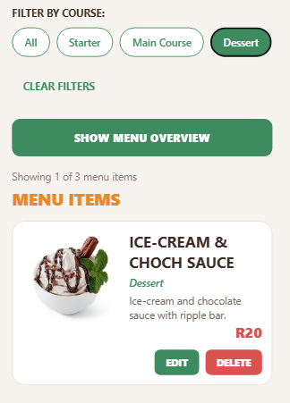
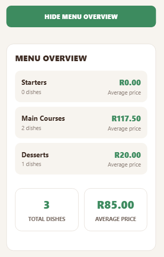
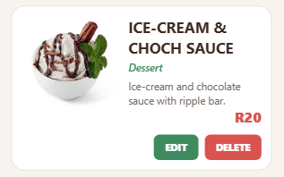
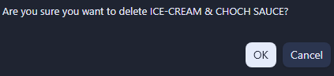

# Chef's Menu Manager

**A React Native mobile application for simple and efficient restaurant menu management.**

## Background

Chef's Menu Manager was developed to address a menu management challenge faced by a local restaurant owner, Christoffel.

Previously, the restaurant's chef relied on paper records to manage menu information. This made it difficult to update dishes, organise menu items and quickly retrieve information when needed.

The application provides a digital solution that allows the restaurant owner to manage menu items directly from a mobile device. It brings menu information together in one place, making it easier to maintain an organised and up-to-date restaurant menu.

The application was developed progressively, beginning with planning and design, followed by the development of a working application and further enhancements to its functionality and user experience.

## Application Features

### 1. Menu Management

Manage restaurant menu items from one central screen. Each menu item displays its name, description, course, price and optional image.

Users can view the complete menu and see the total number of menu items.

### 2. Add Menu Items

Add new dishes using a form that captures:

- Dish name
- Description
- Course (Starter, Main Course or Dessert)
- Price
- Optional dish image

The form includes a Clear Form option to reset entered information before saving.

### 3. Form Validation and Feedback

The application validates form entries before saving a menu item. It checks that required fields are completed and that the price is a valid amount greater than zero.

Clear error messages help users identify and correct invalid entries. Success messages provide feedback when an item is saved successfully.

### 4. Search and Filtering

Find menu items quickly using the search and course-filtering features.

- Search for dishes by name.
- Filter dishes by Starter, Main Course or Dessert.
- Combine search and course filters.
- Clear active filters to return to the complete menu.
- View the number of matching items compared with the total menu items.

### 5. Menu Overview and Statistics

The Menu Overview provides a summary of the restaurant's menu.

It displays:

- Total number of menu items.
- Average price across the entire menu.
- Number of dishes in each course.
- Average price for each course.

The overview can be expanded or collapsed to keep the main menu organised and easy to navigate.

### 6. Edit and Delete Menu Items

Keep menu information up to date by editing existing dishes or removing items that are no longer needed.

- Edit menu item details.
- Update saved menu information.
- Delete menu items with a confirmation prompt.
- Automatically refresh the menu after changes.

Confirmation and feedback messages help users understand when menu items have been updated or deleted successfully.

## User Interface and Experience

Chef's Menu Manager uses a clean and consistent layout to make menu management straightforward.

The application includes:
- Simple navigation between the main menu and the add/edit form.
- Clearly labelled buttons and input fields.
- Consistent colours, spacing and typography.
- Accessible search and filtering controls.
- Clear validation, confirmation and success messages.
- Reusable components to maintain a consistent interface.

## Technologies Used

- **React Native** – Building the mobile application interface.
- **Expo** – Development and application tooling.
- **TypeScript** – Type-safe application development.
- **Expo Router** – Screen navigation.
- **React Hooks** – Managing component state and behaviour.
- **Context API** – Sharing menu data across screens.

## Change Log

This section documents the enhancements and code refactoring implemented after Part 2 of the Chef's Menu Manager application.

### 1. Functional Enhancements

The following features were added to improve menu management:

| Enhancement | Description |
|---|---|
| Total Menu Item Counter | Added a counter displaying the total number of menu items. |
| Edit Menu Items | Added the ability to select an existing dish, modify its information and save the changes. |
| Delete Menu Items | Added the ability to remove menu items, including a confirmation prompt before deletion. |
| Search Functionality | Added the ability to search for menu items by dish name. |
| Course Filtering | Added filtering options for Starter, Main Course and Dessert. |
| Clear Filters | Added a button to reset the search and course filters. |
| Search Result Counter | Added a dynamic counter showing the number of matching items compared with the total number of menu items. |
| Menu Statistics | Added an overview displaying the total number of dishes, overall average price, number of dishes per course and average price per course. |
| Collapsible Menu Overview | Added the ability to show or hide the statistics dashboard. |
| Clear Form | Added a function to reset all form fields and validation messages. |
| Improved Price Validation | Added validation to prevent invalid, zero or negative prices. |
| Improved User Feedback | Added clearer validation, success, update and deletion feedback messages. |

### 2. User Interface and Experience Improvements

The following changes were made to improve usability and consistency:

- Moved the Add New Menu Item button closer to the top of the main screen for easier access.
- Replaced the course dropdown with selectable course buttons.
- Added a dynamic search result count.
- Made the Clear Filters button appear only when a search or course filter is active.
- Made the Menu Overview collapsible to reduce unnecessary scrolling.
- Improved the organisation and presentation of menu statistics.
- Improved the placement and presentation of menu item information and action buttons.
- Maintained consistent colours, spacing, typography and button styling across the application.

### 3. Code Refactoring and Organisation

The existing code was reviewed and reorganised to improve maintainability, readability and code reuse.

| Refactoring | Description |
|---|---|
| Reusable Menu Item Component | Extracted the menu item card interface into `src/components/menu-items.tsx` to avoid repeating the same UI code. |
| Shared Menu Data Management | Used the Context API in `src/MenuContext.tsx` to manage menu items and make the data accessible across application screens. |
| Reusable Validation Functions | Created reusable functions to validate required fields and menu item prices. |
| Centralised Validation Clearing | Created a reusable function to clear validation messages and success feedback. |
| Improved Screen Organisation | Separated the main menu screen and add/edit form into different files using Expo Router. |
| Improved Function and Variable Naming | Used meaningful names to make the code easier to understand and maintain. |
| Reduced Code Duplication | Reused components and functions instead of repeating interface and validation logic. |

These changes improved the application's functionality, organisation and overall user experience while making the code easier to maintain and extend.

## Project Structure

The application is organised into folders and files to separate screens, reusable components, application data and resources.

| Folder / File | Description |
|---|---|
| `assets/` | Contains application images and other static resources. |
| `screenshots/` | Contains screenshots showcasing the application's interface and features. |
| `src/app/` | Contains the application screens and navigation layout. |
| `src/app/_layout.tsx` | Defines the application's navigation layout. |
| `src/app/index.tsx` | Main restaurant menu screen, including menu overview, search and filtering. |
| `src/app/add-menu.tsx` | Form used to add new menu items and edit existing ones. |
| `src/components/` | Contains reusable interface components. |
| `src/components/menu-items.tsx` | Displays individual menu item cards and their actions. |
| `src/MenuContext.tsx` | Manages and shares menu item data across the application. |
| `package.json` | Contains project dependencies and configuration. |
| `README.md` | Provides project information, screenshots and setup instructions.

GitHub Repository: [Chef's Menu Manager](https://github.com/MoeketsiNteo/Chefs-Menu-Manager)

---

*Chef's Menu Manager – Making restaurant menu management simple and organised.*
